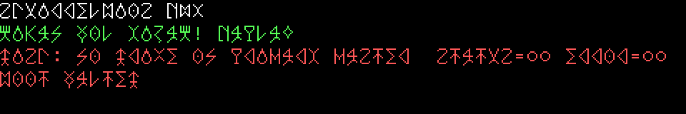

# SquirrelBIOS

> **Joke branch: `klingon-font`.** An alien world where the PC's text font
> was never ASCII. The x86 ROM puts the VGA into 80x25 text mode itself and
> loads a hand-drawn pIqaD 8x16 font, so every letter and digit on
> screen is drawn in Klingon script. COM1 output is unchanged, so the smoke
> tests still pass. Not for merging into `main`; see
> [Klingon font](#klingon-font-joke-branch) below.
>
> 

Platform-specific firmware for Squirrel-OS/2.  
Original code. Hands off to the OS after early init.

```
x86/        64 KB ROM — VGA banner + ATA hand-off to 0x7C00
arm/        AArch64 QEMU virt — PL011 banner + fw_cfg kernel load, DTB in x0
riscv/      RISC-V QEMU virt — UART banner + M-mode jump to -kernel, DTB in a1
tests/      stand-in OS images and smoke tests (make test)
common/     hand-off contract
ROADMAP.md  goals, principles, milestones
TODO.md     small tasks, one per PR
```

## Build

```bash
make          # all
make x86
make arm
make riscv
make clean    # remove all build and test outputs
```

Requires: `nasm`, `aarch64-linux-gnu-as`/`ld`/`objcopy`, `riscv64-linux-gnu-as`/`ld`/`objcopy`.
Other cross prefixes work too: `make AARCH64=aarch64-elf- RISCV64=riscv64-elf-`.

## Test

```bash
make test
```

Builds everything, then boots each firmware under QEMU with a small
stand-in OS image from `tests/` and checks the serial output:

| Case | Passes when |
|------|-------------|
| `x86-boot` | The boot sector runs with `DL = 0x80` and `IF = DF = 0`, and the memory map at `ES:DI` has the required regions, sorted and not overlapping |
| `x86-no-drive` | With no disk, the firmware reports it and halts |
| `x86-mem-low` | With `-m 8`, the map has 7 MB usable at 1 MB (the CMOS `0x30`/`0x31` path) |
| `x86-mem-high` | With `-m 5120`, the map has a non-empty usable entry at 4 GB (CMOS `0x5B`–`0x5D`) |
| `x86-atapi` | With a CD-ROM as primary master, the firmware reports ATAPI and halts |
| `arm-boot` | The `-kernel` image runs with a valid device tree in `x0` and `x1`–`x3` = 0 |
| `arm-no-kernel` | Without `-kernel`, the firmware reports it and halts |
| `riscv-boot` | The `-kernel` image runs on hart 0 (with `-smp 2`) with a valid device tree in `a1` and `a2 = 0`, and nothing traps |
| `riscv-ecall` | An `ecall` from the image reaches the firmware's trap handler, which prints `trap mcause=000000000000000b` and halts |
| `riscv-no-kernel` | Without `-kernel`, the firmware reports it and halts |

Needs `qemu-system-i386`, `qemu-system-aarch64` and `qemu-system-riscv64`.
Serial logs are kept in `build/tests/*.log`. `SMOKE_TIMEOUT` (seconds,
default 10) sets how long each case may take.

CI runs exactly this check: `.github/workflows/make-test.yml` installs
`nasm`, the AArch64 and RISC-V cross toolchains and the three QEMU
system emulators on Ubuntu 24.04, then runs `make test` on every push
and pull request. The serial logs are uploaded as the `smoke-logs`
artifact.

## Run

```bash
# x86 (with a boot sector image); firmware messages appear on COM1
qemu-system-i386 -bios x86/squirrel-bios.rom -drive format=raw,file=boot.bin,if=ide -serial stdio

# AArch64 (image linked at 0x40200000)
qemu-system-aarch64 -M virt -cpu cortex-a57 -nographic -bios arm/squirrel-bios.bin -kernel image.bin

# RISC-V (image linked at 0x80200000)
qemu-system-riscv64 -M virt -nographic -bios riscv/squirrel-bios.bin -kernel image.bin
```

See `common/handoff.md` for the contract each architecture provides.

## Roadmap

[ROADMAP.md](ROADMAP.md) is where this firmware is going.
[TODO.md](TODO.md) is the list of small changes that get there.
One item in that list is one PR, branched from `main`.

## Klingon font (joke branch)

- `tools/klingon-font.py` holds the glyphs as ASCII art and writes
  `x86/klingon-font.inc` (`python3 tools/klingon-font.py > x86/klingon-font.inc`).
  The glyphs are real pIqaD letters, traced stroke for stroke from a
  sixteen-segment pIqaD chart, not copied from an existing font.
- Latin letters map to the nearest Klingon letter (`d`→`D`, `k`/`c`→`q`,
  `x`→`Q`, `f`→`v`, `z`→`S`); only `q` and `Q` differ by case. Digits use
  pIqaD numerals, and `'` is the glottal stop letter.
- `con_putc` folds the romanized `ch`, `gh`, `ng` and `tlh` into one glyph
  each (code points 0x80-0x83) on the VGA side only.
- `vga_init` turns on the display controller's PCI decoding, programs the
  standard 80x25 registers and palette, and loads the font into plane 2.

### Refreshing the branch later

The joke lives in a few self-contained places: `vga_init`/`con_putc`, the
data tables and `banner_tlh` at the end of `x86/squirrel-bios.asm`,
`x86/klingon-font.inc`, `tools/klingon-font.py`, this section and the
Makefile dependency. To pick up new work from `main`:

```bash
git fetch origin main
git checkout klingon-font
git rebase origin/main          # conflicts, if any, are in x86/squirrel-bios.asm
make x86 && make test
git push --force-with-lease origin klingon-font
```

New messages need nothing extra; anything printed through `con_print`
comes out in Klingon.
